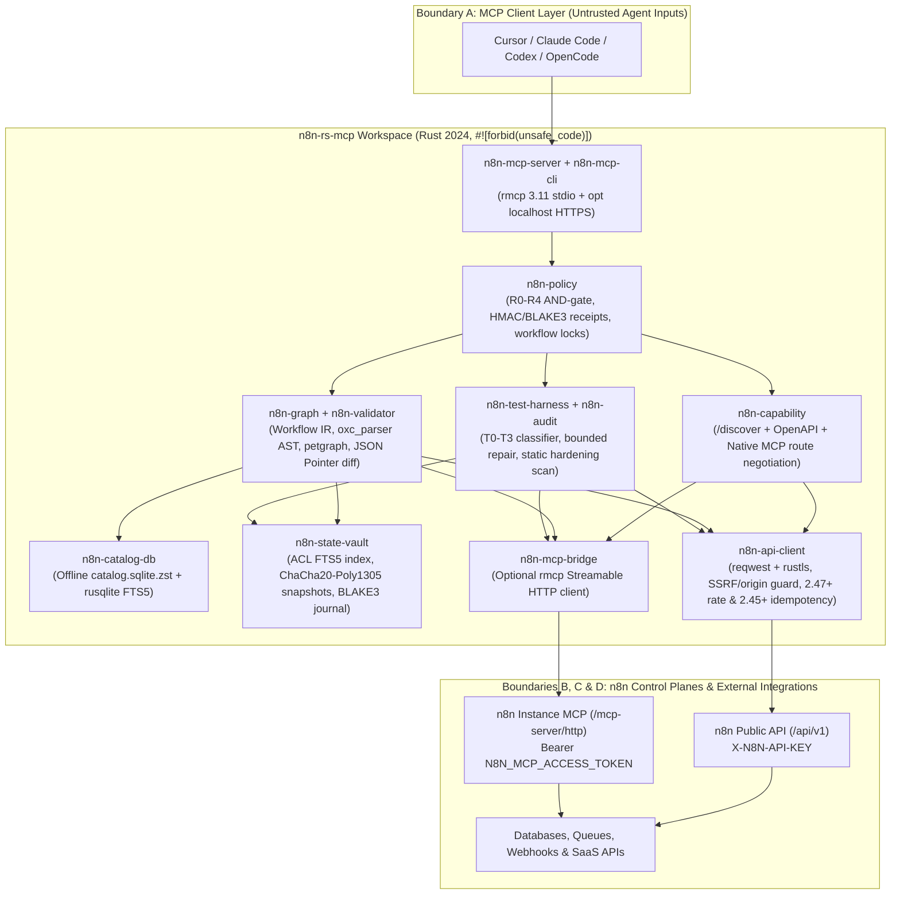

# `n8n-forge-mcp` (`n8n-rs-mcp`)

**Governance-first, Rust-native Model Context Protocol (MCP) server and operator CLI for real n8n workflow authoring, validation, safe testing, auditing, and release control.**

[](LICENSE)
[-orange.svg)](Cargo.toml)
[](Cargo.toml)
[-EA4B71.svg)](docs/API_COMPATIBILITY.md)

`n8n-rs-mcp` connects AI coding agents (**Cursor**, **Claude Code**, **Codex**, **OpenCode**, and MCP `2026-07-28` clients) directly to real **n8n** instances through n8n's documented **Public REST API** (`/api/v1`) and—when separately enabled—n8n's **Instance-Level Native MCP** (`/mcp-server/http`). Unlike stateless API wrappers or offline JSON generators, `n8n-rs-mcp` enforces server-side `R0`–`R4` risk policies, offline FTS5 node/template intelligence, AST-verified expression refactoring, `T0`–`T3` side-effect-gated testing, `ChaCha20-Poly1305` pre-write snapshots, single-use cryptographic `ApprovalReceipt` tokens, and read-after-write verification.

---

## Architecture & Trust Boundaries



- **Dual-Plane Route Selection:** Dynamically negotiates `NativeMcp -> PublicApi -> Local -> Unsupported` per instance using `GET /api/v1/discover?include=schemas` and Native MCP `tools/list`. Never touches undocumented `/rest/*` editor endpoints or browser cookies, and never infers feature availability from `discover.scopes` alone (e.g., `agent:*` scopes without `/agents` endpoints return honest `unsupported`).
- **Draft vs Live Awareness:** Every workflow response tracks both editable draft `versionId` (`versionBefore` / `versionAfter`) and live `activeVersionId`, verifying post-publish activation via read-back rather than trusting HTTP `200` alone.

---

## Capability, Policy & Risk Matrix

### Server-Enforced Policy Profiles (`n8n-policy`)

| Risk Tier | Representative Actions | `read-only` *(Prod Default)* | `staging-safe` *(Staging Default)* | `production-guarded` *(Maint Opt-In)* | `full-dev` *(Development Only)* |
| --- | --- | --- | --- | --- | --- |
| **`R0` Read** | `n8n_capabilities`, `n8n_catalog_*`, `n8n_workflows.list/get`, `n8n_find_nodes`, `n8n_audit` | Allowed | Allowed | Allowed | Allowed |
| **`R1` Prepare** | Offline `n8n_validate`, `n8n_mutate_nodes(preview)`, `T0 (validate_only)` | Allowed | Allowed | Allowed | Allowed |
| **`R2` Draft / Sim** | Inactive draft `create` / `mutate_nodes(apply)`, `T1 (simulate)` *(side-effect gated)* | **Blocked** | Preview + version hash | **Single-use `ApprovalReceipt`** | Preview + version hash |
| **`R3` Live Effects** | `T2 (manual)` staging run, `publish`/`unpublish`, `versions.restore`, `datatables` write | **Blocked** | **Single-use `ApprovalReceipt`** | **Single-use `ApprovalReceipt`** | **Single-use `ApprovalReceipt`** |
| **`R4` Destructive / Admin** | `T3 (production)` run, `delete`, `bulk_codemod` (`<= 20`), `credentials` write, packages, Git, RBAC | **Blocked** | **Blocked** *(unless sub-gate enabled + `R4` receipt)* | **Blocked** *(granular opt-in + `R4` receipt)* | Allowed with `R4` receipt + allowlist |

### Complete MCP Surface (24 Tools, 4 Resources, 5 Prompts)

- **Discovery, Catalog & Validation (`#1`–`#4`):** `n8n_capabilities`, `n8n_catalog_nodes` (native-first node ranking + `displayOptions`), `n8n_catalog_templates`, `n8n_validate` (`oxc_parser` JS/expression AST + topology).
- **Workflow Authoring, Search & Bulk Refactoring (`#5`–`#11`):** `n8n_workflows`, `n8n_find_nodes` (ACL-partitioned sanitized FTS5 index), `n8n_inspect_node_config`, `n8n_mutate_nodes` (16 surgical graph ops, `preview|apply`), `n8n_bulk_codemod` (checkpointed batch cap = 20), `n8n_versions` (`history|diff|snapshot|restore`), `n8n_deploy_template`.
- **Safe Testing, Executions & Evaluations (`#12`–`#14`):** `n8n_executions` (redacted failure summaries, gated `retry|stop|delete`), `n8n_test_workflow` (`validate_only|simulate|manual|production` + bounded 3-step repair loop + durable cleanup leases), `n8n_evaluations`.
- **Data, Credentials, Organization & Security Audit (`#15`–`#19`):** `n8n_explore_resources`, `n8n_credentials` (metadata/schema/guarded write without secret echo), `n8n_datatables`, `n8n_catalog_org` (projects/folders/tags/variables), `n8n_audit` (`observed_facts` vs `heuristics` vs `permission_gaps`).
- **Supply Chain, Git/Promotion, Admin & Agents (`#20`–`#24`):** `n8n_community_packages` (allowlist-locked), `n8n_git_and_packages`, `n8n_admin_access`, `n8n_admin_settings`, `n8n_agents` (capability-gated).
- **Resources (`n8n://`):** `n8n://{instance}/workflows/{id}`, `n8n://{instance}/workflows/{id}/diff/{planId}`, `n8n://{instance}/executions/{id}/summary`, `n8n://catalog/node/{type}/{version}`.
- **Prompts:** `/build-workflow`, `/debug-workflow`, `/refactor-nodes`, `/security-hardening`, `/promote-staging-to-prod`.

See [`docs/USER_GUIDE.md`](docs/USER_GUIDE.md) for per-tool parameters, response envelopes, and client setup for Cursor, Claude Code, Codex, and OpenCode.

---

## Quickstart

### 1. Install or Build `n8n-rs-mcp`

Release builds target Windows x64, Linux x64/arm64, and macOS x64/arm64. When archives are published, download them from [GitHub Releases](https://github.com/vinothhacks/n8n-forge-mcp/releases) and verify their SHA-256 against `SHA256SUMS.txt`. The release workflow also produces build provenance.

To build from source, use Rust `1.99.1`:

```sh
# Build the optimized binary using the committed catalog bundle
cargo build --release --locked --bin n8n-rs-mcp
```

### 2. Verify Connectivity & Policy (`doctor` & `capabilities`)

Supply credentials strictly via environment variables or your OS secret store—never commit API keys to config files:

```sh
export N8N_API_URL="https://staging-n8n.example.internal"
export N8N_ENVIRONMENT="staging"
export N8N_API_KEY="${YOUR_STAGING_API_KEY}"

# Optional: separate token from n8n Settings -> Instance-level MCP
export N8N_MCP_BASE_URL="https://staging-n8n.example.internal/mcp-server/http"
export N8N_MCP_ACCESS_TOKEN="${YOUR_STAGING_MCP_TOKEN}"

./target/release/n8n-rs-mcp sync-catalog --from pinned-bundle
./target/release/n8n-rs-mcp doctor --instance staging --no-secret-output
./target/release/n8n-rs-mcp capabilities --instance staging --format table
```

### 3. Connect Your MCP Client (`stdio`)

```json
{
  "mcpServers": {
    "n8n-forge": {
      "command": "n8n-rs-mcp",
      "args": ["mcp", "--instance", "staging", "--policy", "staging-safe"],
      "env": {
        "N8N_API_URL": "https://staging-n8n.example.internal",
        "N8N_ENVIRONMENT": "staging"
      }
    }
  }
}
```

Ready-to-adapt zero-secret templates are provided in [`examples/instances.example.toml`](examples/instances.example.toml), [`examples/mcp.cursor.example.json`](examples/mcp.cursor.example.json), and [`examples/mcp.claude.example.json`](examples/mcp.claude.example.json).

---

## Security Posture & Honest Operational Boundaries

### Engineered Defenses
- **Memory & Type Safety:** `#![forbid(unsafe_code)]` enforced across all 13 workspace crates; `secrecy::SecretString` + `Zeroize` wrappers for in-memory tokens.
- **Origin-Pinned Credentials & SSRF Defense:** `rustls` HTTPS by default, DNS/IP private-network and cloud-metadata (`169.254.169.254`) blocking, zero HTTP redirect following (`redirect::Policy::none()`), and strict separation of `X-N8N-API-KEY` (`/api/v1`) from `N8N_MCP_ACCESS_TOKEN` (`/mcp-server/http`).
- **Bounded Untrusted I/O:** `16 MiB` post-decompression streaming cap against zip bombs, linear-time `regex` bounds, `1 MiB` AST input cap, and `untrustedContent: true` framing on remote notes/errors.
- **Cryptographic Approvals & Protected Local Vault:** Single-use `HMAC-SHA256` + `BLAKE3` `ApprovalReceipt` tokens bound to `(principal, instance, workflow_id, expected_version_hash, ops_hash)`, per-user OS ACL vault (`0600` Unix / Windows `icacls` DACL), `no_persistent_payload` FTS5 indexing, `ChaCha20-Poly1305` encrypted snapshots, and a `BLAKE3` hash-chained operation journal.

### Explicit Non-Claims (Truthful Limits)
1. **No End-to-End "Zero Leakage" Claim:** Local redaction and memory zeroization cannot recall data sent by a cloud coding agent to its LLM provider or transmitted by n8n workflows to third-party APIs.
2. **Best-Effort Public API Concurrency:** Local per-workflow locks and pre-write TOCTOU version checks prevent internal races, **not** simultaneous clicks in the n8n browser UI during the network round-trip window unless exclusive editing or source-control promotion is used.
3. **Draft Restore != Side-Effect Rollback:** Restoring a workflow version or encrypted snapshot reverts **workflow configuration only**; it cannot undo sent messages, emails, webhook deliveries, payments, or external DB writes.
4. **Conditional Simulation Safety:** Native `test_workflow` pin data does not isolate credential-free `Execute Command` or host filesystem nodes—`n8n-test-harness` blocks risky side-effecting nodes in `simulate` mode rather than running them silently.

---

## Workspace Crate Map (13 Crates)

| Crate | Path | Responsibility |
| --- | --- | --- |
| `n8n-types` | `crates/n8n-types` | `ToolEnvelope<T>`, `OperationStatus`, `RiskLevel` (`R0`–`R4`), `RouteUsed`, `SecretValue` (`Zeroize`), and recursive JSON/string secret redactor |
| `n8n-api-client` | `crates/n8n-api-client` | `reqwest` (`rustls`) `/api/v1` client, `/discover` + OpenAPI loader, SSRF/DNS guard, `2.47+` dual-bucket rate pacing, and `2.45+` `POST` idempotency store |
| `n8n-mcp-bridge` | `crates/n8n-mcp-bridge` | Optional `rmcp` Streamable HTTP client for `/mcp-server/http`, dynamic `tools/list` negotiation, and `skippedOperations`/`removedGroups` inspection |
| `n8n-capability` | `crates/n8n-capability` | Fail-closed capability handshake, legacy `2.3.6` read-only probe fallback, `agent:*` scopes-without-endpoints guard, and TTL cache |
| `n8n-policy` | `crates/n8n-policy` | `PolicyMode` profiles, 5-way AND-gate authorization, single-use `HMAC-SHA256`/`BLAKE3` `ApprovalReceipt` signer, per-workflow `Mutex` locks, and batch cap (`20`) |
| `n8n-catalog-db` | `crates/n8n-catalog-db` | `zstd` + `BLAKE3`-verified offline `catalog.sqlite.zst` reader (`rusqlite` bundled FTS5), native-first ranking, `displayOptions` evaluator, and templates |
| `n8n-graph` | `crates/n8n-graph` | Lossless Workflow IR (`versionId` vs `activeVersionId`, `main`/error/`ai_*` ports), loop-aware `petgraph` analysis, 16 surgical mutations, and semantic/JSON Pointer diffs |
| `n8n-validator` | `crates/n8n-validator` | Schema/credential validator, `oxc_parser` JS & `={{ ... }}` expression AST analyzer, safe literal node rename rewriter, and `Why Code:` check |
| `n8n-state-vault` | `crates/n8n-state-vault` | Windows DACL / Unix `0600` vault, `(principal, instance, project, workflow)` sanitized FTS5 index, `ChaCha20-Poly1305` snapshots, and `BLAKE3` hash-chained journal |
| `n8n-test-harness` | `crates/n8n-test-harness` | `T0`–`T3` test orchestrator, static side-effect node classifier, bounded 3-attempt repair loop, redacted diagnostics, and durable cleanup lease reconciler |
| `n8n-audit` | `crates/n8n-audit` | Static workflow security and reliability scanner separating `observed_facts`, `heuristics`, and `permission_gaps`, plus `/api/v1/audit` integration |
| `n8n-mcp-server` | `crates/n8n-mcp-server` | `rmcp 3.11.0` `ServerHandler` registering all 24 tools, 4 `n8n://` resource templates, 5 prompts, `doctor`, and optional localhost HTTPS transport |
| `n8n-mcp-cli` | `crates/n8n-mcp-cli` | `clap` operator binary (`n8n-rs-mcp`) exposing `mcp`, `doctor --no-secret-output`, `capabilities`, `sync-catalog`, and `reconcile` |

---

## Development & Verification

```sh
# 1. Install git pre-commit zero-secret guard locally
git config core.hooksPath .githooks

# 2. Rebuild and verify deterministic catalog.sqlite.zst + manifest digests
python3 tools/catalog-builder/build_catalog.py --out-dir data

# 3. Format, strict Clippy lint gate, and full workspace test suite (including 356 equivalence cases)
cargo fmt --all -- --check
cargo clippy --locked --workspace --all-targets -- -D warnings
cargo test --locked --workspace
```

### Documentation Index
- **User & Client Guide:** [`docs/USER_GUIDE.md`](docs/USER_GUIDE.md)
- **Operations & Security Runbook:** [`docs/OPERATIONS.md`](docs/OPERATIONS.md)
- **Production Release Gate (`U01`–`U18` & Targets):** [`docs/RELEASE_GATE.md`](docs/RELEASE_GATE.md)
- **n8n Version & API Compatibility Matrix:** [`docs/API_COMPATIBILITY.md`](docs/API_COMPATIBILITY.md)
- **Threat Model & Trust Boundaries:** [`docs/THREAT_MODEL.md`](docs/THREAT_MODEL.md)
- **Authorization & Cryptographic Approval Model:** [`docs/APPROVAL_MODEL.md`](docs/APPROVAL_MODEL.md)
- **Third-Party Notices & Provenance:** [`docs/THIRD_PARTY_NOTICES.md`](docs/THIRD_PARTY_NOTICES.md)

---

## License & Trademark Notice

Dual-licensed under **[MIT OR Apache-2.0](LICENSE)** at your option. See [`docs/THIRD_PARTY_NOTICES.md`](docs/THIRD_PARTY_NOTICES.md) for third-party attributions (`czlonkowski/n8n-mcp` MIT catalog provenance and Rust crate notices).

`n8n` is a trademark of **n8n GmbH**. `n8n-forge-mcp` (`n8n-rs-mcp`) is an independent clean-room open-source project and is not affiliated with, sponsored by, or endorsed by n8n GmbH.
