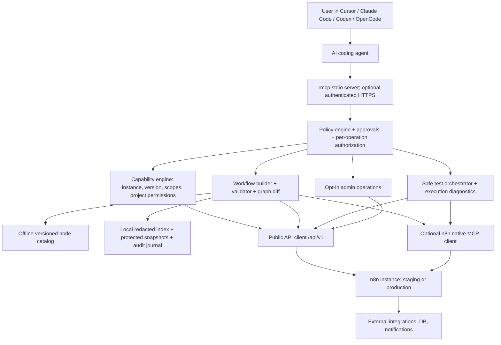

# n8n-rs-mcp: Production-Ready Rust MCP Build Plan (V2)

**Status:** Engineering implementation specification, not a claim that software is already built.  
**Reviewed:** 2026-11-22  
**Target n8n baseline:** 2.48.7 stable (2026-11-20); support older versions by tested feature negotiation.  
**Rust MCP SDK baseline:** `rmcp` 3.11.0 (2026-11-17), pinned and verified in CI.  
**Clients:** Claude Code, Cursor, Codex, OpenCode and other clients supporting MCP `stdio` (preferred) or authenticated Streamable HTTP.  
**Product:** `n8n-rs-mcp`, a Rust-native control, inspection, validation, testing and governance layer for n8n.

> **Answer to the main question:** Once this server is implemented, connected and authorized, an agent **can directly create, find, edit, validate, test, debug, publish, unpublish and manage n8n workflows**. The Rust server sends operations to **the real n8n instance** through its supported Public API and, optionally, the instance's built-in MCP server. Changes appear in n8n itself. This is **not** an offline workflow designer or a substitute for n8n. Some features require a newer n8n version, a separate instance-level MCP token, additional permissions or human approval. Tests that call real integrations may have irreversible side effects.

## 0. Decision and acceptance contract

### Required outcomes

1. Build real workflows from natural-language requests: choose appropriate native n8n nodes, configure parameters and credentials by **reference**, connect graph ports, validate and create drafts in a chosen project/folder.
2. Inspect any authorized existing workflow, find its nodes quickly, edit node parameters/code/connections without blindly overwriting other changes, and verify the saved result.
3. Test safely: offline validation first; mock/pin-data tests in an isolated environment when supported; explicit approval for real execution. Read errors and help agents repair failures in an edit-test-verify loop.
4. Publish a reviewed workflow with the selected n8n version/permissions; verify which version is live. Support unpublish and restoring a saved workflow draft when available.
5. Provide fast indexed search across accessible workflow nodes, expression references, credential *references* and misconfigurations without leaking credential secrets or sensitive execution items into agent contexts.
6. Automatically discover what each n8n connection can actually do; **never interpret lack of permission as a request to bypass it**.
7. Keep production safe by default: visible diffs, per-operation authorization, explicit user approval for consequential actions, audit evidence and recovery instructions.

### Explicit non-goals / prohibited claims

- No guarantee of "zero data leakage" merely because the server is written in Rust; agent providers and returned tool payloads must also be trusted and governed.
- No automatic bypass of n8n API-key scopes, project roles, licenses, instance protection, SSO or workflow approval processes.
- No blanket guarantee that every graph expression can be rewritten, that every n8n node has a locally known schema, or that any workflow can be run via the Public API alone.
- No claim that `GET` then `PUT` is atomic optimistic concurrency; no claim that multi-workflow rollback undoes external effects (sent emails, payments, writes, messages).
- No automatic public webhook testing against production, no automatic installation of untrusted community nodes, no default production execution.
- Performance and binary size are benchmarks, **not** guaranteed properties before measurement. No Node.js requirement at Rust-server runtime; n8n itself still has its own runtime.

### Capability and action matrix

| User request | Planned MCP tool | Preferred underlying route | Important precondition |
| --- | --- | --- | --- |
| List/search workflows | `n8n_workflows`, `n8n_find_nodes` | Public API; native MCP search where authorized | Workflow/project visibility |
| Create a workflow and its nodes | `n8n_workflows`, `n8n_deploy_template` | Native MCP `validate_workflow` + `create_workflow_from_code`, else Public API `POST /workflows` | Create permission; validate before write |
| Change node parameters/code | `n8n_mutate_nodes` | Native MCP `update_workflow` partial ops when available; otherwise guarded API read-modify-write | Editor permission; dry-run; conflict guard |
| Add/remove/rename/connect nodes | `n8n_mutate_nodes` | Native MCP partial updates or local graph transformation plus API update | Graph validation and safe-reference checks |
| Validate a draft | `n8n_validate` | Offline Rust checks; native MCP `validate_node_config`/`validate_workflow` as applicable | Validation does not equal successful live execution |
| Test safely with example data | `n8n_test_workflow` | Native MCP `prepare_workflow_pin_data` + `test_workflow`, with isolation/policy checks | Available MCP token; safe node policy; non-prod preferred |
| Run with real credentials | `n8n_test_workflow` (`mode=manual` or `production`) | Native MCP `execute_workflow` or an explicitly allowed trigger interface | Explicit approval; may produce real effects |
| Read execution failures | `n8n_executions` | Public API executions, native MCP execution details | Redacted by default; restricted reveal privilege |
| Retry/stop execution | `n8n_executions` | Documented Public API if available | Approval; retry can duplicate side effects |
| Publish/unpublish | `n8n_workflows` | Public API publish/unpublish or native MCP | Version review, authorization, confirmation |
| Restore previous draft | `n8n_versions` | Native MCP restore/history or local prior snapshot | Does **not** reverse external side effects |
| Manage credentials/projects/admin | `n8n_credentials` and admin tools | Explicitly supported Public API/native MCP capability | Minimal scopes; high-risk admin approval |

### Example end-to-end experience

User says: "In staging, create a webhook -> validate payload -> PostgreSQL insert -> Teams notification workflow. Test it, fix the failure and show me the diff before publishing."

1. Agent calls `n8n_capabilities`: chooses **staging**, confirms write rights, identifies API/MCP routes and supported nodes.
2. Agent calls `n8n_catalog_nodes` and `n8n_validate`: selects node versions and their effective fields; verifies credentials are available by reference, never obtains raw secrets.
3. `n8n_workflows.create` writes a **draft**, returns its real n8n workflow ID and UI URL. This can use n8n's native `validate_workflow` / `create_workflow_from_code` or validated Public API JSON.
4. `n8n_test_workflow` runs a policy-permitted mock/pin-data test, reads a redacted failure and proposes an exact edit. An actual PostgreSQL insert or Teams send requires **separate approval** and isolated test credentials.
5. `n8n_mutate_nodes.preview` returns a before/after diff; approved apply saves the change, verifies it on the server and reruns the safe test.
6. Only if the user approves publication does `n8n_workflows.publish` publish the vetted draft and check the active version. It returns an operation receipt, evidence, residual risks and a rollback path.

---

## 1. Architecture and trust boundaries



**Trust boundaries:** (A) agent -> Rust MCP; (B) Rust MCP -> n8n Public API; (C) Rust MCP -> native n8n MCP bridge; (D) n8n -> third-party systems. Authorization at one boundary does not grant authorization at another. Only the n8n engine performs real workflow execution. Agent-generated content and tool-returned data are untrusted input for policy purposes.

**Default runtime:** one local `stdio` MCP process per operator, with separate state and identities. In remote HTTP mode, authenticate each client, bind its identity to a **separate** n8n credential/profile and policy, and isolate state/indexes/snapshots accordingly. Never share a global Owner key across multiple untrusted users.

### Internal components

1. **MCP front end:** 24 cohesive typed tools, resources and prompts; small default tool descriptions; optional dynamic tool list with `list_changed` notification where the client supports it. The router always enforces policy at call time even when a tool is visible.
2. **Capability resolver:** per-instance live feature map, API scopes, operation-level permissions, n8n version, license/feature probes, native MCP availability, read-only protection and feature TTLs.
3. **Transport clients:** `reqwest` Public API client and optional `rmcp` Streamable HTTP client for native instance MCP. Credentials and auth contexts are separate.
4. **Graph/validator engine:** n8n workflow graph IR, node schema and conditional-option evaluator, AST-aware expression checks, topology validator, mutation planner and diff.
5. **Execution/testing engine:** deterministic offline tests where possible, simulated/pin-data tests, controlled staging runs, sanitized diagnostics and cleanup reconciler.
6. **State, search and audit:** offline node catalog, sanitized indexed metadata, encrypted on-demand snapshots and redacted append-only mutation journal.
7. **Approvals/recovery:** dry-run plans, bound confirmation receipts, version checks, operation statuses, reconciliation and human-readable recovery instructions.

---

## 2. n8n version and API capability rules

**Docs baseline:** n8n 2.48.7 stable as of 2026-11-22. API routes and field shapes must be verified against the connected instance's **actual** discover/OpenAPI response and integration tests. Features documented in newer docs must not be assumed on older servers.

| Feature | Source-based availability / interpretation | Required implementation behavior |
| --- | --- | --- |
| Public API-key scopes | All plans from n8n 2.14.0; older non-Enterprise behavior differs | Least-privilege keys; never infer project rights from scopes alone |
| `GET /api/v1/discover?include=schemas` | Present in current API reference; older-server availability must be probed | Use supported operation IDs and request schemas; 404 -> documented safe fallback |
| Native MCP workflow build tools | `validate_workflow`, `create_workflow_from_code`, `update_workflow` documented from 2.12.0; broader client-building docs say 2.13.0 | Detect tool list; do not rely on hard-coded minimum alone |
| Native MCP partial `update_workflow` | Partial operations from 2.20.0; batch is server-atomic except skipped node-group operations from 2.41.0 | Prefer for surgical updates, check `skippedOperations` and `removedGroups` |
| Native MCP `validate_node_config` | From 2.25.1 | Fallback to offline schema checks; distinguish strength of validation |
| Native MCP `test_workflow` | From 2.15.0 | Uses pin data but **can still run credential-free I/O**; only in approved test context |
| Native MCP `execute_workflow` | Exists in current MCP tools reference | Manual uses draft, production uses published graph; requires supported trigger and rights |
| Native MCP trigger selection | `triggerNodeName` from 2.36.0 | Ambiguous triggers on older instances: fail safely, do not guess |
| Native MCP `prepare_workflow_pin_data` | Renamed from `prepare_test_pin_data` in 2.34.0 | Negotiate actual advertised name |
| Native MCP workflow version restore | `restore_workflow_version` from 2.29.0 | Fallback to snapshot restore **as draft**, with approval |
| Public API idempotent POST | From 2.45.0, only on endpoints that advertise support | Use same key and exact request on retry; max 12-hour successful-response window |
| Public API rate limits | From 2.47.0; **off by default**, configurable by admin | Respect both global/endpoint and read/write buckets when enabled; header-driven pacing |
| Native MCP protected instance | From 2.47.0, protects non-read-only tools but permits production `execute_workflow` | Our own `read-only` policy still **blocks** real execution by default |
| Active vs draft n8n workflow | `versionId` draft and `activeVersionId` / published version | Always report both, never assume a draft edit changes live production |
| Workflow builder node groups | Additional checks/skip reporting from 2.41.0 | Verify groups after write; do not claim all ops succeeded if some skipped |
| `rmcp` protocol | Pin `rmcp` 3.11.0; supports MCP 2026-07-28 and backward negotiation | Support modern `stdio` and Streamable HTTP; test relevant client protocol versions |

### Source documentation to drive implementation

- Public API workflows: https://docs.n8n.io/connect/n8n-api/build-and-run/workflows.md
- Public API executions: https://docs.n8n.io/connect/n8n-api/build-and-run/executions.md
- Discovery: https://docs.n8n.io/connect/n8n-api/instance-operations/discover.md
- Authentication and scopes: https://docs.n8n.io/connect/n8n-api/authentication.md
- Rate limits: https://docs.n8n.io/connect/n8n-api/rate-limits.md
- Idempotency: https://docs.n8n.io/connect/n8n-api/idempotency.md
- Native n8n MCP tools reference: https://docs.n8n.io/connect/connect-to-n8n-mcp-server/mcp-server-tools-reference.md
- Native MCP setup and permission notes: https://docs.n8n.io/connect/connect-to-n8n-mcp-server.md
- `rmcp` SDK and release notes: https://github.com/modelcontextprotocol/rust-sdk , https://github.com/modelcontextprotocol/rust-sdk/releases
- n8n releases: https://github.com/n8n-io/n8n/releases

### Native MCP prerequisites

Native instance-level MCP requires separate enablement and authentication: use the **server URL** that n8n supplies under **Settings > Instance-level MCP**, normally ending in `/mcp-server/http`, and the applicable client authorization/token. Its availability in a workflow is not the same as an API key's ability to read that workflow. The instance-level server has its own workflow exposure and per-user access rules. Never send the Public API key as a substitute for native MCP authentication without explicit documentation that it is accepted.

### Runtime feature handshake (authoritative, fail-closed)

```text
1. Resolve active instance alias, its configured trust level and authenticated principal.
2. Resolve URL strictly; require HTTPS except explicit loopback development mode.
3. GET /api/v1/discover?include=schemas when available.
4. Parse advertised scopes, resources, operationIds and request schemas.
5. If 404/unsupported, use a minimal READ-ONLY probe set; don't probe stateful methods.
6. If configured, connect to native instance MCP, call initialize and tools/list.
7. Derive per-operation route: NativeMCP / PublicAPI / LocalValidation / Unsupported.
8. Enforce project/workflow rights based on actual resource checks, not role names alone.
9. Apply local policy: dev/staging/prod, read-only, action approval and target allowlist.
10. Cache low-risk metadata briefly; recheck permission/feature state before mutating.
11. Return `available`, `unavailable`, `unknown`, or `blocked_by_policy` with reason.
```

Distinguish `401` invalid/expired authentication; `403` insufficient rights/feature restriction; `404` absent *or* concealed resource; `409` conflict; `422` validation; `429` rate-limited. A 404 cannot alone establish a version limitation. **Never fall back to undocumented editor/private n8n endpoints.**

---

## 3. Configuration and deployment

### Secure single-instance MCP example

```json
{
  "mcpServers": {
    "n8n": {
      "command": "n8n-rs-mcp",
      "args": ["mcp", "--instance", "staging", "--policy", "staging-safe"],
      "env": {
        "N8N_API_URL": "https://staging-n8n.example.internal",
        "N8N_ENVIRONMENT": "staging"
      }
    }
  }
}
```

**Important:** Have the host launch/injection layer supply `N8N_API_KEY` through an environment secret, a supported OS secrets mechanism, or a protected launcher. Client JSON support for inherited env/secret substitution differs; verify it in `doctor`. Do **not** commit plaintext API keys in `mcp.json`, repositories, bug reports or transcripts. A test-only local JSON with a literal key can be supported for compatibility but must be clearly marked insecure and excluded from VCS. A user must explicitly authorize any credential creation or modification.

### Optional native n8n MCP bridge

```text
N8N_MCP_BASE_URL=https://staging-n8n.example.internal/mcp-server/http
N8N_MCP_ACCESS_TOKEN=<injected secret; not checked into config>
```

The native bridge is **optional**. Missing native bridge does not prevent Public API workflow creation/editing if those endpoints are authorized. It *can* prevent native `test_workflow`, `execute_workflow`, dynamic `loadOptions` and Workflow SDK builder features; mark them unavailable instead of pretending the Public API is equivalent.

### Multi-instance policy file (example, no secrets)

```toml
# ~/.config/n8n-rs-mcp/instances.toml (permissions 0600)
[instances.staging]
url = "https://staging-n8n.example.internal"
environment = "staging"
policy = "staging-safe"
api_key_env = "N8N_STAGING_API_KEY"
mcp_token_env = "N8N_STAGING_MCP_TOKEN"

[instances.prod]
url = "https://n8n.example.internal"
environment = "production"
policy = "read-only"
api_key_env = "N8N_PROD_API_KEY"
# Intentionally no native MCP bridge in default production profile.
```

CLI commands:

```sh
n8n-rs-mcp doctor --instance staging --no-secret-output
n8n-rs-mcp capabilities --instance staging --format table
n8n-rs-mcp sync-catalog --from pinned-bundle
n8n-rs-mcp mcp --instance staging --policy staging-safe
```

`doctor` checks DNS/TLS, API reachability, version, scopes, native MCP connectivity if enabled, startup protocol, state-store permissions, feature contracts and a non-mutating list operation. Report missing rights; never request an Owner key as an automatic fix.

### Remote HTTP security (optional, not V1 default)

- Secure TLS termination, strong per-client authentication (JWT/OAuth/mTLS as supported by deployment), distinct per-client n8n principal, and request Origin/Host validation.
- No anonymous binding to `0.0.0.0`; limit listener to localhost by default, with explicit bind and reverse-proxy allowlist to expose remotely.
- Separate per-identity caches, quota/budget, audit stream, OAuth scopes if applicable, and token encryption. Do not trust MCP `readOnlyHint` annotations as an authorization mechanism.
- Validate request size, concurrency, HTTP method/content-type and timeouts. Prevent credentials from being forwarded to any origin other than the explicitly associated n8n API / native MCP origin.
- Reject redirect chains to non-allowlisted origins; validate DNS/IP destination policy to prevent localhost, metadata-service and private-network SSRF (unless that exact trusted private host is the configured destination).
- No telemetry or crash-report egress of secrets/payloads. Keep network/egress allowlists narrow, but recognize n8n itself may call arbitrary services when workflows execute.

---

## 4. Exact MCP tool surface (24 tools, no unnecessary bloat)

Keep the original plan's 24 logical tools and route individual operations to the **best documented API**, not to an imagined privileged generic endpoint. Use compact JSON Schema output, structured failure reasons, `detail=minimal|standard|full` and pagination. Tool names are stable. Discovery returns active capabilities and actions for the selected instance. **A visible tool does not imply authorization.**

| # | Tool | Core operations | Default risk / route |
| --- | --- | --- | --- |
| 1 | `n8n_capabilities` | Instance profiles, scopes, feature matrix, native MCP tools, permissions, protection, version, rate limits | Read-only / discovery |
| 2 | `n8n_catalog_nodes` | FTS node search, node operations, effective fields, version/credential types, native-first hints | Read-only / offline + native schema |
| 3 | `n8n_catalog_templates` | Search and inspect templates/patterns; return topology or deployable JSON | Read-only / offline |
| 4 | `n8n_validate` | Node, workflow JSON, optional Workflow SDK code; graph/expression/config validation | Read-only / offline + native validation |
| 5 | `n8n_workflows` | List, get, create, clone, update metadata, archive, unarchive, publish, unpublish, transfer, delete | Read/create/write/high risk / Public API/native MCP |
| 6 | `n8n_find_nodes` | Cross-workflow type/name/parameters/expression/credential-reference/health search | Read-only / sanitized index |
| 7 | `n8n_inspect_node_config` | Effective parameters, defaults, options/fixedCollection, upstream data *shape* | Read-only / graph + schema |
| 8 | `n8n_mutate_nodes` | Set/unset/patch, add/remove/rename, connect/rewire, reliability, credential binding, layout, group edit; `preview|apply` | Write / prefer native partial update |
| 9 | `n8n_bulk_codemod` | Select multiple workflows, preview, per-workflow apply, checkpoint, stop, resume, best-effort restore | High risk / explicitly approved |
| 10 | `n8n_versions` | History, snapshots, semantic diff, draft restore, release notes | Read/write (restore) / native + local |
| 11 | `n8n_deploy_template` | Instantiate a validated template in selected project/folder, map credential refs | Write / native builder or API |
| 12 | `n8n_executions` | List/get/summarize failure, retry/stop/delete/annotate where supported | Read or consequential write / API |
| 13 | `n8n_test_workflow` | `validate_only|simulate|manual|production`; prepare fixtures, run, poll, summarize | Simulate/real execution / native MCP + approved triggers |
| 14 | `n8n_evaluations` | Inspect/run/cancel AI evaluation test runs when feature exists | Read/execute / capability-gated |
| 15 | `n8n_explore_resources` | Dynamic dropdown/loadOptions/listSearch; resource IDs by existing references | External read may occur / native MCP; consent if network |
| 16 | `n8n_credentials` | Schema, permitted metadata list, create/update/move/delete using supported APIs | Sensitive write / credential-scoped |
| 17 | `n8n_datatables` | Schema/rows/CRUD/upsert where available | Data access or write / scoped API/native MCP |
| 18 | `n8n_catalog_org` | Projects/folders/tags/variables supported by version and rights | Read/write / API |
| 19 | `n8n_audit` | Official audit where authorized; **local static** workflow hardening report otherwise | Read-only / API + offline scan |
| 20 | `n8n_community_packages` | Inventory, inspect, approved install/update/uninstall | Admin/high-risk / supported API only |
| 21 | `n8n_git_and_packages` | Source-control status, guarded push/pull, promotion, `.n8np` import/export when licensed/supported | Admin/high-risk / API only if advertised |
| 22 | `n8n_admin_access` | Admin-only projects, project memberships, users, RBAC/SSO settings supported by instance | Admin/high-risk |
| 23 | `n8n_admin_settings` | Supported rate limit/security/node policies, observability and insights | Admin/high-risk |
| 24 | `n8n_agents` | List/manage n8n persisted Agents when actual bridge/API advertises them | Optional; do not promise on 2.48.7 solely by name |

Expose optional read-only MCP resources:

```text
n8n://{instance}/workflows/{id}
n8n://{instance}/workflows/{id}/diff/{planId}
n8n://{instance}/executions/{id}/summary
n8n://catalog/node/{type}/{version}
```

Expose prompts `/build-workflow`, `/debug-workflow`, `/refactor-nodes`, `/security-hardening`, `/promote-staging-to-prod`, but treat prompt templates as **guidance**, not privileges. A programmatic agent must still call tools with explicit inputs and respect approvals.

### Tool response envelope

```json
{
  "status": "success|preview|blocked|unsupported|conflict|partial|error",
  "instance": "staging",
  "operationId": "opaque-operation-id",
  "workflowId": "real-id-or-null",
  "action": "mutate_nodes",
  "permission": "allowed|needs_approval|denied|unknown",
  "routeUsed": "native_mcp|public_api|local",
  "versionBefore": "draft-version-or-null",
  "versionAfter": "draft-version-or-null",
  "changed": true,
  "warnings": [],
  "diff": { "summary": "bounded redacted summary" },
  "verification": { "state": "verified|inconclusive|not_run", "details": [] },
  "nextActions": [],
  "auditId": "opaque-audit-id"
}
```

The envelope is illustrative; define one strict Rust/JSON Schema contract per operation. Never claim `success` based only on HTTP 200 when the native MCP result contains skipped operations, deferred publication, or a nonterminal execution status. Mark `partial` or `inconclusive` accurately.

---

## 5. Authorization and production policy engine

The policy is **server enforced**, independent of agent instructions, MCP tool visibility or client annotations.

### Operation risk levels

| Risk | Examples | Default policy |
| --- | --- | --- |
| R0 - Read | Metadata search, schema lookup, version comparison, redacted diagnostics | Allowed when permitted by n8n and profile |
| R1 - Safe prepare | Local validation, dry-run diff, sanitized fixture generation | Allowed, bounded resources |
| R2 - Draft write | Create or edit an inactive workflow in staging, add a node, change draft metadata | Staging only after preview; apply requires explicit tool-level action intent |
| R3 - Real effects | Execute with real integrations, retry, data-table writes, publish/unpublish, transfer | Explicit user confirmation for exact action, target, side-effect scope |
| R4 - Destructive/admin | Delete, stop bulk executions, install packages, change access, source control pull/push, production publish | Strong human approval, optional independent reviewer; deny under default production profile |

`read-only` has **no effect-producing calls** even if native n8n protected mode allows `execute_workflow(production)`. `staging-safe` allows approved draft changes, simulated tests by policy and no silent external side effects. `production-guarded` must be explicitly enabled and uses confirm tokens per action. `full-dev` may enable broader operations only on a configured local disposable instance. A compromised model should not be able to set or elevate its own policy.

### Preview -> confirmation -> commit (TOCTOU-aware)

1. Agent submits exact target and requested change. Server checks scope, project permissions, policy and instance.
2. Server reads current draft and active identifiers, creates **redacted** semantic diff and side-effect estimate, generates `plan_id` and hashed plan metadata (instance, principal, workflow, version/hash, operations, expiry, risk).
3. Server returns `preview`; client presents summary. External actions require **user review and confirmation of exact target and operation** before the commit.
4. Confirmation creates a short-lived, one-use authorization receipt bound to the same principal, instance, operations and expected state. A model-generated string or repeated `apply=true` is **not** sufficient to impersonate a user's confirmation.
5. Server rechecks permissions and graph state just before commit and declines stale or changed plans. Server locks by instance+workflow for **other writes going through this Rust service**.
6. Server calls the best supported n8n operation; retrieves saved workflow; verifies version, graph and active publication status.
7. Journal `verified`, `conflict`, `partial`, or `unknown_result`; return traceable receipt.

**Critical concurrency limit:** There is no proven universal atomic compare-and-swap for Public API workflow writes merely because a workflow returns `versionId`. A local lock cannot prevent a human n8n UI edit or another client update. If the selected endpoint lacks a documented atomic precondition, use a safe maintenance/exclusive-edit window or require explicit risk acceptance for high-impact production updates. Pre- and post-checks reduce risk but **do not guarantee** no lost update. Never fabricate an HTTP `409` if the server did not return one; use internal `CONCURRENT_EDIT_DETECTED` / `WRITE_RESULT_UNCERTAIN` as appropriate.

### Additional controls

- Never mutate a resource in a different instance than the selected alias. A client may not override target hostname/port through a tool parameter.
- `read_only`, protected workflow/archived state, user rights and API scopes form an AND policy: **any deny wins**.
- Validate approved workflow/project IDs and scope against the actual API/MCP response; a role label such as Owner does not grant an unrestricted route by itself.
- For bulk operations, preview all affected workflows and report exact target count, permissions and expected side effects. Require elevated confirmation; default limit = 20 workflows per batch and 1 concurrent write to a workflow.
- Role, credential, package, production and source-control changes are disabled until their individual acceptance tests pass and are explicitly enabled in the policy.
- Tokens are scoped to one action/target; no generic `confirm_all` switch. Even approved operations revalidate service-side policy.
- When confirmation cannot be represented securely by the MCP client, return a preview and direct the user to an out-of-band approval flow; **do not auto-approve**.

---

## 6. Public API client and optional native MCP client

### Public API client

`n8n-api-client` owns:

- Versioned, typed endpoint definitions generated or checked against connected `/discover` schema and documented OpenAPI; `reqwest` with rustls, strict redirect behavior, per-instance URL normalization and network allowlisting.
- Scoped headers: `X-N8N-API-KEY` **only** to the configured Public API origin; Cloudflare Access headers, if used, only to their configured origin; native MCP token **only** to native MCP origin.
- Timeouts: connection, overall, body/read and long operation wait. Response byte budget before decompression (and after) with incremental bounded streaming; do not request giant `ignoreDataSizeLimit` results in the default path.
- Pagination with cursor handling, per-request cancellation, bounded concurrency and request budget; exact typed parsing and structured errors.
- Rate limiting from 2.47.0: separate key-level read/write plus per-endpoint read/write windows. Use `Retry-After`, `X-RateLimit-Limit/Remaining/Reset` when present; if disabled, use a conservative local limit.
- Idempotency: use `Idempotency-Key` only on **supported POST** endpoints from 2.45.0. Persist a sanitized operation reference and exact request canonical bytes for permitted retry; do not repeat a POST with a new key after uncertain network failure. It is ignored for GET/PUT/PATCH/DELETE, and the server retains successful POST responses for only 12 hours.
- Failure policy: retry throttled/connection failures only when semantics establish safe retry. A transport timeout after a mutating operation creates **unknown outcome**, requiring read-after-write reconciliation, not blind repetition.
- Error mapping: clear authentication, permission, absent/unsupported feature, validation, conflict, throttling, timeout and result-unknown statuses with no raw secrets in diagnostics.

### Native MCP bridge

Use `rmcp` client to connect to the instance's `/mcp-server/http` endpoint only when the user separately enables and authorizes it. Select its documented tool names **dynamically** from `tools/list`; call `validate_workflow` before `create_workflow_from_code` when using Workflow SDK code. Prefer built-in partial `update_workflow` for supported changes; it offers per-batch atomicity, **not a documented cross-client compare-and-swap**. Inspect `skippedOperations`, `removedGroups`, `autoAssignedCredentials`, warning and error fields after each call.

When a node's credential is auto-assigned by native builder tools, report it without secret material. Do not auto-assign a credential to an HTTP Request node where native MCP explicitly skips it; provide a manual/actionable binding instruction instead.

### Route selection algorithm

```text
For each logical operation:
  verify policy + instance + principal + resource permission
  evaluate available native MCP tools and exact version/field support
  evaluate Public API discover operation / request schema
  prefer native MCP when it offers safer targeted semantics
  otherwise use documented Public API with local validation and preview
  otherwise allow LOCAL-ONLY inspection/validation where meaningful
  otherwise return UNSUPPORTED with unmet prerequisite
  never use private editor APIs, browser session cookies or privilege bypasses
```

Do **not** downgrade a failed `403` to a different route that achieves the same unauthorized effect. A fallback may only use authorized user-visible resources and never cross project boundaries.

---

## 7. Node catalog, workflow graph and semantic search

### Catalog origin and version pinning

Use a versioned, signed/compressed offline `catalog.sqlite.zst` produced from appropriately licensed public node metadata and documented schemas. Catalog content includes `node_types`, `node_versions`, `properties`, `operations`, credential types, conditional display rules, templates, source provenance, extraction date and source version. De-duplicate by `(type, typeVersion, schema_hash)`. Do not blindly assume that all offline versions exist on the connected instance.

`n8n_catalog_nodes` prioritizes native Set/IF/Switch/HTTP Request and existing n8n integrations rather than Code nodes for tasks expressible with standard nodes. Schema inspection evaluates `displayOptions.show/hide` based on the current operation and version, including `options` and `fixedCollection` fields. Treat unknown/new community node schemas as **partial confidence**. Empirical inference from readable workflows only describes observed fields; it must not claim the complete schema.

### Sanitized live index

Build a read-only index from accessible `GET /workflows` and authorized per-workflow fetches. Include workflow/project/folder, node IDs, display names, type/version, safe parsed metadata, dependency references, connection topology, credential *type/reference hashes*, health flags and observed timestamp/version/hash. Cache full `parameters` only after explicit sensitivity classification; **default to no plaintext parameter JSON** because node params often contain tokens, bearer headers and customer data.

Search operators:

```text
workflow_id, project_id, folder_id, active_only, graph=draft|published,
node_type, name_pattern, disabled, param_path + safe predicate,
references_node, uses_variable, credential_type, stale_type_version,
missing_error_handler, recent_failure_count, page_token, max_results
```

Index data by `(principal_id, instance_id, project_id, workflow_id, version_hash)`. Recheck access before responding from cache. Revoke/purge index partitions when an identity loses permissions. Cache TTL and pagination are explicit. For sensitivity-restricted parameter queries, perform authorized **ephemeral in-memory scan** and return only node IDs + matched field names; never persist the queried secret or a matching raw value.

### Graph invariants and transformations

- Nodes have stable IDs and unique names. `connections` and `pinData` can be name-keyed. `nodeGroups` refer to node IDs. Check all supported representations by n8n version.
- Validate all connection port types/indexes, including `main` branches, error output and AI sub-node ports (`ai_languageModel`, `ai_tool`, `ai_memory`, etc.).
- Support legitimate workflow back-edges and iterative/loop nodes; **do not** reject every directed cycle using a generic DAG validator.
- AST-inspect JavaScript expressions and supported n8n expression syntax. Rename only literal references that can be parsed with confidence; when references are dynamic (`$('prefix' + name)`, computed properties, templated references), **refuse automatic rename or require manual review**.
- Preserve unchanged expressions/field values byte-for-byte when possible. Do not automatically rewrite prompts, query strings or user-authored data outside a detected n8n reference.
- Keep node `typeVersion`, credential bindings, webhook IDs, branch semantics, groups and metadata consistent. Auto-layout must only reposition nodes explicitly requested or added, not reformat an entire established canvas.
- Produce `diff_summary`, `json_patch`, `graph_diff`, `risk_flags`, `validation_report`, `expected_version_hash`, `approval_required` and `plan_id` before any mutation.

### Mutations and specialized edit semantics

Operations: `set_params`, `unset_params`, `patch_text_field`, `configure_reliability`, `bind_credential`, `add_node`, `remove_node`, `rename_node`, `insert_node_between`, `remove_node_bridge`, `connect`, `disconnect`, `rewire`, `auto_layout`, `set_node_groups`, `upgrade_node_version`.

`set_params` should support documented native JSON Pointer semantics when routed to built-in MCP. Note: native `setNodeParameter` **does not support array indices**; use a whole-array replacement or controlled Public API update with preview. Avoid claiming arbitrary dotted or JSONPath mutation syntax is server native. Where possible, prefer native partial operations rather than full workflow `PUT` to reduce collateral changes.

`upgrade_node_version` is not a simple numeric bump. Require an explicit, versioned migration transform and equivalence fixtures; without one, report `migration_missing` and leave the node unchanged. Credential binding matches type and permission and never displays credential secret values.

### Concurrent edit model

```text
read current draft + active versions -> create sanitized plan -> secure approval
-> per-workflow local write lock -> fresh read and semantic precondition check
-> prefer n8n atomic partial batch for the individual workflow
-> check partial/skipped operations -> fetch and verify target graph
-> record verified state or uncertain outcome -> release lock
```

Document that this is **best-effort concurrency protection** against independent n8n UI writers. It becomes a strong no-lost-update guarantee only if the selected server endpoint exposes and enforces an atomic conditional-write precondition or the deployment ensures exclusive editing.

---

## 8. Safe execution, testing and agent debugging loop

**Testing must be designed as a controlled spectrum, not a single "run" switch.** n8n's native MCP `test_workflow` uses pin data to bypass credentialed/HTTP nodes but still executes other nodes normally. A credential-free file-write or Execute Command node may have effects even in a supposedly mocked run. Restrict tests to approved test instances and deny or stub all disallowed side-effecting nodes.

### Test modes and guarantees

| Mode | Input | Execution location | Default permission | What it proves |
| --- | --- | --- | --- | --- |
| `validate_only` (T0) | Workflow JSON/SDK code, schemas | Rust offline, optionally native validation | Default allowed | Structural/syntax/supported field checks only; **not** runtime correctness |
| `simulate` (T1) | Synthetic fixture + safe node allowlist | Native MCP `test_workflow` on isolated staging; otherwise limited Rust deterministic checks | Allowed only if capability and safety policy satisfied | Supported flow logic under controlled data; may not replicate external services |
| `manual` (T2) | Test input with staging credentials | n8n native MCP `execute_workflow(manual)` or approved staging webhook | Explicit approval | End-to-end on staging; **real staging side effects** |
| `production` (T3) | Approved production input | n8n native MCP `execute_workflow(production)` or normal live trigger | Explicit high-risk approval; off by default | Real live execution, possibly irreversible |

**Do not label T1 as guaranteed safe until you have inspected the graph and runtime policies.** If the only available route would hit real data, return `requires_approval` rather than silently using T2/T3.

### Deterministic test safety gate

Before any n8n execution:

1. Resolve exact instance, principal, workflow ID, draft or published version, trigger and input preview.
2. Classify all reachable nodes, including nested Execute Workflow calls, Code nodes, Execute Command, filesystem, external network, queues and database writes. Evaluate side effects of subworkflows when visible; otherwise mark **unknown** and fail closed.
3. For `simulate`: require allowed node set or staging-level sandbox where all side-effect pathways are blocked; use pin data for credentialed nodes and HTTP Request nodes; never assume pinning blocks credential-free I/O nodes.
4. For `manual`/`production`: require user review of exact version/trigger/input, target credentials, data stores, external destinations and anticipated effects. Use test credential bindings in staging.
5. Limit duration, executions, response bytes, recursion/depth, external egress and bulk impact. A timeout does not imply the n8n run stopped; query/stop when authorized.
6. Return a result with `executionId`, status, actual/expected output shapes, failing node, sanitization summary and next suggested edit. `started` is not `success`.
7. Do not automatically retry real execution on failure, since a partial run may have already sent messages or written data.

### Preferred test route selection

```text
if requested mode == validate_only:
    run offline validation; optionally native validation if available
elif requested mode == simulate:
    if native MCP test_workflow available AND staging/sandbox policy passes:
        prepare sanitized pin data (tool name negotiated by version)
        call test_workflow; verify result and execution diagnostics
    elif purely deterministic local evaluation supported for this node subset:
        run limited offline checks with clear "NOT real n8n execution" label
    else:
        return UNSUPPORTED_SIMULATION with prerequisites; do not escalate
elif requested mode == manual:
    require confirmed staging target + approved side effects
    prefer native execute_workflow(manual) when supported
    else invoke a specifically allowlisted staging test endpoint for that trigger
elif requested mode == production:
    require production-guarded profile + explicit human approval
    call supported native execute_workflow(production) / authorized live endpoint
else:
    reject invalid mode
```

### Older/API-key-only fallback

Public API-only mode can always perform **authorized draft writes, graph validation and execution inspection** where API endpoints exist. It must **not** claim universal ability to manually execute arbitrary Schedule/Manual-triggered workflows. If a supported webhook/form/chat test URL exists, explicit allowlisted staging invocation may be available. Other cases return a clear limitation and a recommendation to enable the native MCP bridge or use an isolated n8n test instance.

The original plan's ephemeral webhook-clone runner is moved to an **optional advanced experimental adapter**, with all of these gates:

- Staging-only disposable n8n instance/project, independent test credentials, no production datastore access, blocked outbound egress except allowlisted mock endpoints.
- Explicit permission to create a temporary workflow and invoke its temporary trigger; use a unique, authenticated, non-public one-shot webhook and verify request origin/path.
- Never silently replace schedule or manual semantics; explain that trigger differences may make results non-equivalent.
- Pin or stub all external effects. Do not preserve production credentials or real customer sample data in the clone.
- Write a persistent cleanup **lease/journal before creation**; after test, unpublish/delete with read-back verification. On crash, a separate startup reconciler finds abandoned test resources and cleans them within authorized policy.
- If cleanup fails, mark `cleanup_required` and alert the operator. Do not claim "guaranteed cleanup" from a Rust `Drop` handler.

### Agent-driven diagnose -> edit -> test loop

```text
1. n8n_executions.get(error summary) -> sanitized failing node + error class
2. n8n_workflows.get(draft vs published) -> current editable graph
3. n8n_inspect_node_config -> effective fields and safe data shapes
4. n8n_validate -> detect broken expression/ports/schema/reliability
5. n8n_mutate_nodes.preview -> exact minimal patch and risk analysis
6. approved n8n_mutate_nodes.apply -> verify saved state
7. n8n_test_workflow(mode=simulate) -> safe result, if supported
8. if still failing, repeat under configured max iterations
9. human review before a real execution or publication
```

Bound automatic repair to **3 attempts by default**, 5 maximum with explicit per-session override. Never auto-retry real sends/inserts/payments; compare execution input shape, error, node config and version between attempts. If confidence remains low, return a diagnosable issue instead of guessing.

### Execution data minimization

- Default `get` = `summary` with status, duration, failed node, error code, truncated redacted text, request IDs and safe schema of upstream items.
- `node_io` and `full` are **restricted**; need specific permission and additional approval when data can reveal secrets or personal information. Respect n8n's execution `redactExecutionData` policy and do not automatically request `execution:reveal` scope.
- Redact patterns and configured sensitive JSON fields recursively **before** serialization to MCP, local cache, logs, screenshots or metrics; avoid raw body/stack traces containing credentials.
- Cap responses after decompression and enforce total response/item limits. Never assume streaming alone makes huge `runData` safe.
- Keep original raw execution content only on n8n, subject to its own retention and encryption policy; Rust holds bounded safe summaries by default.

---

## 9. Versioning, batch codemods, rollback and recovery

### Per-workflow operation journal

Maintain a state machine per operation:

```text
PLANNED -> PREVIEWED -> USER_APPROVED -> PREPARING -> WRITING
  -> VERIFYING -> VERIFIED
                       \-> PARTIAL / CONFLICT / UNKNOWN_RESULT / FAILED
```

Write an append-only redacted record of approved scope, base version/hash, target workflow, operation checksum, actual HTTP/MCP outcome, verification result and recovery status. Preserve audit integrity by hash chaining and rotation; do not store raw secrets in audit records.

### Snapshots

- Capture a pre-write snapshot **only for authorized, necessary graph state**. Remove credential values and any sensitive hardcoded parameter fields where the user does not authorize encrypted retention.
- User-specific protected storage; no shared plaintext `state.db`. Metadata remains in SQLite. Encrypted snapshots use an authenticated encryption implementation and OS-managed/per-user key separate from the DB. If no secure key is available, default to memory-only transient snapshots or disable persistent restore.
- Snapshot identity `(principal, instance, project, workflow, version/hash, timestamp)` with integrity hash and bounded retention; allow explicit purge/export after redaction review.
- A snapshot can restore **a workflow draft/configuration**. It does not recall webhook calls, external DB writes, emails, payments, messages, credential changes or deleted execution history.

### Bulk codemod contract

1. Dry-run match selector over a fixed authorized snapshot of target workflow IDs; return exact targets and redacted diffs.
2. Require elevated human confirmation for exact targets; prohibit selector widening after approval.
3. Record a durable batch plan and per-target checkpoints before writes.
4. Apply per workflow, with its own lock, permissions, version pre-check, native partial batch or guarded API write, and read-back verification.
5. On first critical failure, stop further writes. Mark which workflows are verified, failed or unknown; offer a separate explicitly approved **best-effort restore** plan for already changed workflows.
6. Run after-restart reconciler for stale/unknown operations. Do not declare the batch atomic: n8n API has no general cross-workflow transaction.

### Production release path

`draft -> validate -> simulated test (safe) -> real staging test (approved) -> reviewed diff -> publish approval -> publish -> verify live version -> monitor`. If source control / package promotion is used, additionally check credential/variable/datatable bindings, target project and license, and obtain separate production approval.

A Public API response `200` with a saved `versionId` is not enough to declare a published version active. Check `activeVersionId` or native publication state, where supported, and report delayed trigger registration or workflow review gates.

---

## 10. Credentials, data protection and supply chain

### Credentials

1. API key and native MCP token are separate secrets with independent scope and rotation; provide no plaintext access to logs, debug print, error display, telemetry or agent response.
2. Credential tools return only allowed metadata/reference IDs and schema; n8n holds actual encrypted credentials. Creating/updating credential **data** must use a user-approved protected input channel; the model should not be required to repeat a secret in chat.
3. `bind_credential` validates credential type, resource visibility, project permissions and node compatibility. On ambiguity, ask the user to select a credential or return alternatives by nonsecret label.
4. No exporting or reverse-reading credentials. Reuse existing approved references; do not automatically create a privileged credential in order to make a test pass.
5. Use `secrecy`/`zeroize` for Rust secret handling, but note that zeroization **cannot** erase copies already sent over a network, logged by another service, held by an LLM provider or persisted by n8n.

### Storage boundaries

- `catalog.db` contains only public/approved catalog metadata, checksums and version provenance.
- `state.db` contains indexes of safe fields, capability cache, redacted audit and encrypted-snapshot metadata; `state.db` permissions `0600` where supported. Use OS-specific per-user protected directory on Windows/macOS rather than hard-coded Unix paths.
- Separate `snapshots/` encrypted blobs from SQLite. Control per-principal keys, TTL, secure purge policy and backup rules.
- For workflows containing highly sensitive data, select `cache_policy=no_persistent_payload`, avoid indexed parameter values, and return only node metadata.
- Do not leak customer data through template examples, exception formatting, audit trail, shell command output or `mcp.json`.

### Community node and admin supply-chain controls

- Inventory without mutation is normally allowed if authorized. Install/update/uninstall requires admin rights, package allowlist, exact package/version lock, publisher and integrity check, change review and rollback preparation.
- Default reject unsigned/unknown package sources; **do not execute untrusted npm package scripts** as a silent side effect of an agent call. Network/sandbox restrictions should apply during package installation.
- Dynamic node schemas for community packages must be treated as untrusted definitions (potentially very large/malformed); bound parsing and processing.
- Do not use proprietary `n8n` server implementation or Enterprise `.ee.ts` code for automated source translation without an explicit license review. Integrate through supported public documented interfaces.

### Security scanner

`n8n_audit` must distinguish:

- **Observed facts:** public webhook without known auth, missing `retryOnFail`, sensitive node type, broad external URL, code node using `$env`, unbounded failure loop patterns, stale credentials by reference.
- **Heuristics:** potential secrets in raw parameters, suspicious URLs, missing error handling, possible SSRF or data egress. Report evidence safely and do not claim exploitability without testing.
- **Permissions-limited gaps:** unreadable workflows, hidden credentials, unsupported enterprise modules, inaccessible production configuration.

No active penetration testing or production invocation occurs as part of a static audit. A secret scanner's findings should redact secret values and show safe locations, never the matched secret.

---

## 11. Rust workspace design

```text
n8n-rs-mcp/
|-- Cargo.toml                  # workspace, edition 2024; lockfile committed
|-- rust-toolchain.toml         # pin MSRV/toolchain after CI verification
|-- crates/
|   |-- n8n-mcp-cli/           # mcp, doctor, capabilities, sync-catalog, setup
|   |-- n8n-mcp-server/        # rmcp stdio + optional HTTPS; 24 tools/resources/prompts
|   |-- n8n-api-client/        # reqwest, /discover, auth, rate limits, idempotency
|   |-- n8n-mcp-bridge/        # optional client to native n8n instance-level MCP
|   |-- n8n-capability/        # version+permissions+feature profile
|   |-- n8n-policy/            # approval, role, risk, resource, allowlists
|   |-- n8n-graph/             # workflow IR, reference analysis, graph ops/diff
|   |-- n8n-validator/         # node schema, expressions, JS parser, safe rules
|   |-- n8n-catalog-db/        # node catalog, FTS5, templates, provenance
|   |-- n8n-state-vault/       # sanitized index, encrypted snapshots, journal
|   |-- n8n-test-harness/      # test modes, runtime safety, cleanup reconciler
|   |-- n8n-audit/             # workflow reliability/security checks
|   `-- n8n-types/             # common typed DTOs, errors and operation receipts
|-- data/
|   `-- catalog.sqlite.zst     # versioned, built/reviewed offline asset
|-- config/
|   |-- policy.dev.toml
|   |-- policy.staging.toml
|   `-- policy.prod-read-only.toml
|-- examples/
|   |-- mcp.cursor.example.json
|   |-- mcp.claude.example.json
|   `-- instances.example.toml
|-- tests/
|   |-- contract/              # OpenAPI and native MCP tool schema snapshots
|   |-- equivalence/           # Rust-Anything cases.jsonl and expected behavior
|   |-- wiremock_n8n/          # auth, scopes, 404, 409, 429, truncated payloads
|   |-- integration/           # disposable Docker n8n on pinned releases
|   |-- chaos/                 # timeout, reconnect, stale auth, partial writes
|   |-- fixtures/              # redacted synthetic sample workflows
|   `-- security/              # no leaks, SSRF, unauthorized, parser fuzzing
|-- tools/
|   `-- catalog-builder/       # reproducible, provenance-checked catalog build
|-- docs/
|   |-- API_COMPATIBILITY.md
|   |-- THREAT_MODEL.md
|   |-- APPROVAL_MODEL.md
|   |-- USER_GUIDE.md
|   |-- OPERATIONS.md
|   |-- RELEASE_GATE.md
|   `-- THIRD_PARTY_NOTICES.md
`-- .github/workflows/         # lint, tests, SBOM, signed release artifacts
```

### Rust crates and responsibilities

| Dependency | Intended use | Guardrail |
| --- | --- | --- |
| `rmcp` / `rmcp-macros` 3.11.0 | MCP server + optional client bridge | Pin lockfile; verify features in CI |
| `tokio`, `futures` | Async execution and cancellation | Bounded tasks/concurrency; no leaked background loops |
| `reqwest` + rustls | REST, TLS, bounded streaming | Strict origins and redirects; cert validation on |
| `serde`, `schemars` | Typed DTO and tool schemas | Deny unknown mutating fields where feasible |
| `rusqlite` bundled FTS5 | Catalog and sanitized state index | Per-user DB and no plaintext secret persistence |
| `zstd`, `blake3` | Snapshot compression and content checks | Hash not equivalent to secrecy; encrypt separately |
| `secrecy`, `zeroize` | Secret handling | No debug formatting; zeroize best-effort only |
| `oxc_parser` and span tools | JS/TS syntax/ref AST checks | n8n expression grammar may need custom extraction |
| `petgraph` | Graph traversal, ports and reachability | Permit legitimate cycles/back-edges |
| `serde_json_path`, `jmespath` | Controlled query language for safe metadata | Query execution limits and bounded results |
| `regex`, `similar` | Safe text patches and diffs | Reject unsupported regex constructs; bound input |
| `governor` (optional) | Local rate limiter | Server headers are authoritative when present |
| Authenticated encryption implementation (selected in ADR) | Encrypt persisted snapshots | External OS key management and key rotation plan |

Use `#![forbid(unsafe_code)]` for project crates unless the team documents a justified exception; dependency internals may use unsafe. Prefer typed `Result` error propagation; no panics on untrusted n8n JSON. Reproducible builds and lockfile pinning are mandatory.

---

## 12. REA MCP and Rust-Anything development workflow

**Keep both tools strictly development-time.** Neither REA nor Rust-Anything should be installed as a runtime requirement of the distributed `n8n-rs-mcp` binary.

### REA inspection sequence

1. Inspect MIT-licensed reference project's catalog `nodes.db`, table/index DDL, FTS tokenizer settings and known non-secret sample records. Capture schema maps and version provenance.
2. Inspect the MIT reference's validators, conditional property filters, workflow differ and autofix behavior; record documented edge cases and failure modes. Review third-party license/attribution obligations.
3. Record **synthetic/redacted** Public API/native MCP wire exchanges from a disposable n8n development instance with separate Owner, scoped Member and read-only identities.
4. Generate a versioned API capability fixture and contract tests; never treat a HAR from one version as proof for all versions.

### Rust-Anything sequence

```text
analyze -> record -> build -> diff -> bench -> gate
```

Port only isolated deterministic behavior from appropriately licensed source: `displayOptions` matching, schema validation, simple workflow diff operations, AST expression reference extraction, parameter transforms with recorded migration cases. Keep original copyright/attribution where legally required. **Do not** feed n8n proprietary/Enterprise server code to a source translator as a shortcut.

The equivalence corpus should cover: 2,000+ varied node definitions where available, nested options, fixed collections, Unicode node names, arrays, known n8n expression shapes, multi-output AI ports, malformed JSON, missing credentials and both valid loop and invalid graph cases. Separate **intentional improvements** from compatibility regressions.

Quality gate per crate: `cargo fmt --check`, `cargo clippy --all-targets -- -D warnings`, unit/property tests, fuzz tests for parsers, dependency/SBOM/license review, error-path tests and sanitizer/static analysis where practical. No network/credential dependencies in deterministic unit tests.

---

## 13. Delivery roadmap with stop/go gates

Do **not** attempt all 24 tools as a first milestone. Ship an auditable read-only core first, then controlled write/test operations, then optional admin. This is a sequence of acceptance-driven milestones rather than an unreliable duration estimate.

### Phase 0 - Contract, threat model and fixtures

**Build:** ADRs for Public API vs native MCP routing, credential boundary, approval mechanism, concurrency claims, state encryption and test isolation; synthetic Docker n8n dev environment; versioned fixture bundle; source provenance and licensing checks.

**Gate:** `API_COMPATIBILITY.md`, `THREAT_MODEL.md`, `APPROVAL_MODEL.md` are approved; n8n 2.48.7 demo instance and at least one legacy-version fixture exist; test credentials point only to disposable systems.

### Phase 1 - Rust foundation, discovery and policy

**Build:** Cargo workspace, typed MCP tools and errors, `stdio` transport, config loader, secret injection, Public API client, `/discover`/safe fallback, native MCP handshake, policy checks, request budgets, timeouts, and `doctor`.

**Gate:** Owner, scoped Member, read-only and expired-key fixtures produce correct tool capabilities; unauthorized operations fail closed; no secrets in outputs/logs; all 429 tests obey server `Retry-After`.

**Tools:** `n8n_capabilities`, minimal `n8n_workflows` read, `n8n_validate` skeleton.

### Phase 2 - Read-only intelligence (first shareable release)

**Build:** node catalog/FTS5, template search, sanitized workflow graph/index, `n8n_find_nodes`, effective `n8n_inspect_node_config`, offline validators, redacted execution error summaries and local audit.

**Gate:** Query across 200 synthetic workflows returns correct scoped results; all read-only operations leave instance state unchanged; cross-tenant index leakage tests pass; unknown node versions are marked partial, not falsely validated.

**Tools:** `n8n_catalog_nodes`, `n8n_catalog_templates`, `n8n_find_nodes`, `n8n_inspect_node_config`, read-only `n8n_executions`, `n8n_audit`.

### Phase 3 - Real create and edit in staging (first core functional release)

**Build:** `n8n_workflows.create/get/update`, `n8n_mutate_nodes` preview/apply, graph operations, native `validate_workflow` + `create_workflow_from_code` and partial `update_workflow` routing, Public API fallback, optimistic pre/post checks, local locks, approval receipts, protected snapshots and verification journal.

**Gate:** Agent creates real staged workflows and safely modifies them; no write occurs before approval when required; partial native operations report skipped groups; stale edits/unknown results are surfaced; live published graph remains unchanged unless explicitly published.

**Tools:** `n8n_workflows` core, `n8n_mutate_nodes`, `n8n_deploy_template`, `n8n_versions` read/snapshot.

### Phase 4 - Testing, debugging and guarded publication

**Build:** T0/T1/T2/T3 mode routing, native MCP test tools, runtime node/side-effect classifier, test fixtures, redacted execution diagnostics, approved real staging run, optional guarded production run, publish/unpublish with active-version verification, cleanup reconciler and bounded repair loop.

**Gate:** Safe test path does not access production credentials or external endpoints; credential-free filesystem/command nodes are blocked in simulated mode; run failure returns useful evidence; production execution/publish require exact approval; post-publication active version is verified.

**Tools:** `n8n_test_workflow`, full `n8n_executions` with sensitive operations gated, `n8n_workflows.publish/unpublish`, `n8n_versions.restore`.

### Phase 5 - Bulk, resources and organization

**Build:** bounded multi-workflow codemods, checkpoints/resume/reconcile, data-table operations, credential schema/metadata operations, project/folder/tag/variable management, evaluations and approved dynamic resource lookup.

**Gate:** A failed workflow in a batch halts the batch and produces exact per-target status; restore is explicitly described as best effort; data-table writes are user-approved and scoped; read-only tests show no unauthorized data access.

**Tools:** `n8n_bulk_codemod`, `n8n_credentials`, `n8n_datatables`, `n8n_catalog_org`, `n8n_evaluations`, `n8n_explore_resources`.

### Phase 6 - Optional administration and production hardening

**Build:** admin integrations only for endpoints advertised on that instance, package governance, source control/promotion, RBAC/settings, audit receipts, secrets/key rotation, remote HTTPS gateway if required, compatibility matrix, SBOM and release signing.

**Gate:** Admin actions are hidden or blocked for scoped users and cannot be invoked through an alternative route; package installs enforce allowlists; remote principal isolation passes; disaster-recovery exercise completed; zero unapproved effects in red-team tests.

**Tools:** `n8n_community_packages`, `n8n_git_and_packages`, `n8n_admin_access`, `n8n_admin_settings`, optional `n8n_agents`.

### Release milestones

| Milestone | Agent can do | Not yet promised |
| --- | --- | --- |
| **M1 - Inspector** (Phases 0-2) | Connect, search, inspect, validate, diagnose offline | Writes, live test execution, publish |
| **M2 - Builder** (Phase 3) | **Directly create/edit real n8n staging workflows** | Automatic real execution, admin |
| **M3 - Safe operator** (Phase 4) | **Create -> edit -> safe test -> diagnose -> guarded publish** | Universal test safety, no human approval for production |
| **M4 - Enterprise operator** (Phases 5-6) | Bulk updates, governed resources, optional admin and promotions | Bypass of scopes, unconditional cross-instance transactions |

---

## 14. Comprehensive verification plan

### Contract and compatibility matrix

Use pinned Docker/fixture coverage for:

- n8n **2.48.7**: full target matrix, native MCP builder, partial update, pin-data testing, publish/unpublish, idempotency and rate limits when enabled.
- n8n **2.47.x**: protected instance behavior, rate limits and native tool differences.
- n8n **2.45.x**: POST idempotency and supported endpoint matrix.
- n8n **2.20.x / 2.14.x / 2.12.x**: availability and syntax differences; missing operations return honest `unsupported`.
- n8n **2.3.6** (if the organization still runs it): establish what Public API operations work and deliberately disable untested advanced routes. Treat it as a legacy-compatibility target, not a safe production baseline.
- At least one deliberately unsupported/404 simulated version and one license-restricted fixture.

Do not assert a version is supported simply because `doctor` can log in. Each compatibility row needs a tested operation, request/response schema evidence and a known limitation.

### Core E2E user acceptance cases

| ID | User command | Pass criteria |
| --- | --- | --- |
| U01 | "Find all HTTP Request nodes calling our deprecated endpoint" | Correct authorized node hits; no raw URL secrets; bounded pagination |
| U02 | "Create webhook -> Set -> IF -> Teams draft in staging" | Real n8n draft ID and UI URL, correct node types and graph |
| U03 | "Add a retry to a selected node and set timeout" | Exact preview, approval, minimal staged change, read-back verified |
| U04 | "Rename a node without breaking downstream expressions" | Literal references repaired, dynamic references safely flagged; no silent corruption |
| U05 | "Edit an IF branch and insert a node between A and B" | Branch index semantics preserved, schema validated, node IDs stable |
| U06 | "Test with this mock data and fix the failed mapping" | No disallowed real I/O; error evidence; max repair attempts; final test status |
| U07 | "Execute this test workflow with staging credentials" | Explicit approval; correct trigger; execution ID; actual result polled; no duplicate retry |
| U08 | "Publish this reviewed draft" | Correct approval; actual `activeVersionId` verified; complete receipt |
| U09 | "Do the same in production without confirming" | **Blocked**, with plan preview and approval instructions |
| U10 | "Change these 30 workflows" | Default batch limit blocks; explicit narrowed selector and approval required |
| U11 | "Restore yesterday's workflow" | Draft state restored where supported; statement that external side effects remain |
| U12 | "Change another project's credential using this API key" | Denied by n8n permission/local policy; no privilege fallback |
| U13 | "Test a workflow with Execute Command and File Write" | Simulation denied or isolated in a verified sandbox; never silently run on host |
| U14 | "Update while another person edits in n8n" | Detect pre-apply drift where possible; if atomic guard absent, state concurrency limitation and abort high-risk operation |
| U15 | "Retry a timed-out POST create" | Reconcile first; use same idempotency key/bytes only where supported; no duplicate create |
| U16 | "Try an unsupported endpoint on an old instance" | Clear unsupported/unknown reason, no private endpoint or admin workaround |
| U17 | "Search workflows after losing project access" | Index partition cleared/inaccessible; no cached result leak |
| U18 | "Create a workflow and then encounter failure before response" | Reconcile whether workflow exists before any retry; return uncertain receipt if unresolved |

### Failure injection / security cases

- 401 expired key, 403 no scope, 404 concealed resource, 409 publish conflict, 422 validation error, 429 with both limit buckets, request timeout after commit, canceled MCP client and malformed native MCP response.
- Internal SSRF targets, redirect to another origin, DNS changes, cross-origin auth header leak, secrets in URL/headers/Code node, 60 MB compressed response bomb, 10 MB error stack and JSONPath/regex pathological input.
- Unknown n8n node type, stale node version, disconnected AI sub-node, valid loop, multiple trigger ambiguity, node rename with computed JavaScript reference, partial update skipped groups.
- Interrupted batch mid-write, machine crash before cleanup, lost approval token, two Rust instances writing same workflow and simultaneous human UI edit.
- MCP client with no approval interface, malicious prompt embedded inside workflow notes or error payload, untrusted node schema instructions, log-injection text from execution data.

### Release gate (objective)

- **Security:** 0 unapproved writes/executions in policy tests; 0 secrets in sample MCP responses/logs/caches/snapshots; no cross-user/project index leakage; SSRF/auth-redirection tests pass. Do not promise mathematically zero future vulnerabilities.
- **Correctness:** 100% pass on mandatory deterministic contract/equivalence and E2E fixtures; every mutating tool emits a verified or uncertain result, never unverified success.
- **Approval:** All R3/R4 operations require separately verified user action; change of instance/target after approval is rejected.
- **Compatibility:** Exact tested version/operation matrix published. Unknown or absent capability never produces false `success`.
- **Recovery:** Chaos tests validate journal, reconcile, rollback-plan generation and cleanup of abandoned staging harnesses where authorized; external effects never falsely described as reversed.
- **Performance:** With a fixed hardware and catalog fixture, measure binary size, startup P50/P95, idle RSS, cached search P50/P95 and 2-hour rate-limited soak. Initial **engineering targets**: <25 MB single binary where supported, <25 MB idle RSS, <50 ms warm cached-node search over 200 workflows, low hundreds of ms cold start in standard test environment. Adjust goals using actual measurements; no sub-15 ms startup guarantee.
- **Portability:** Signed artifacts with checksums/SBOM, reproducible builds for Windows, macOS (arm64/x64) and Linux (arm64/x64) where CI runners exist. Rust binary static linking is target-dependent, not universal.

---

## 15. Operability, logging and reliability

Metrics (safe cardinality): MCP request count/latency/error class by tool; n8n API latency/429, timeouts and remote 5xx; authorized read vs write counts; approval outcomes; cache hits/misses and index age; state-vault bytes; test-duration/status; uncertain writes; cleanup backlog; native bridge health; version compatibility mismatches.

Log record fields: timestamp, redacted operation ID, opaque user/client identity, instance alias, action/risk, HTTP method and **path template** (no secret URL), status, duration, audit trace ID, versions/hashes, sanitized error class. Do not include workflow node parameters, input payloads, credentials, auth headers or raw customer data by default.

Reliability design:

- Bounded queues per principal/instance and per operation; cancellation prevents new writes but never assumes a submitted remote write was canceled.
- Cancellation after commit -> reconciliation to verify whether it succeeded. Treat network timeouts as unknown outcomes, not automatic failure.
- Short TTL capabilities and read metadata; invalidate on writes/permission changes; no stale cached authorization grants.
- Separate development and production API keys, storage namespaces and log sinks; production read-only alias must never silently point to staging and vice versa.
- Startup checks for orphan test resources, incomplete operations, expired snapshots and stale tokens; cleanup actions require the same authorization and are auditable.
- Disaster recovery: export sanitized catalog metadata, approved encrypted snapshots and journal; exercise restart/rebuild of local index without losing n8n data.

---

## 16. Product limits to show in agent responses

Use these exact truthful constraints in tool documentation and user messaging:

1. **"Creates/edits in real n8n"** means the workflow is persisted through an authorized n8n interface and verified by reading it back. Before connection the tool cannot change anything in a user's instance.
2. **"Tests"** means either offline/static validation, a policy-safe simulated test, or an explicitly approved execution. The result must specify which mode was used. Static validation alone is not an end-to-end runtime test.
3. **"Safe simulated testing"** is conditional: pin data does not guarantee isolation of credential-free file/command operations. Deny or sandbox risky nodes.
4. **"Publish"** is consequential and must require exact authorization. A saved draft is not necessarily the version serving real traffic.
5. **"Rollback"** restores a configuration/draft only. It cannot undo sent notifications, third-party requests or data changes performed in executions.
6. **"Refactoring safe"** covers parseable/literal references and tested graph shapes; dynamic references and unsupported custom nodes need manual inspection.
7. **"No leakage"** cannot be absolutely guaranteed. The Rust process should minimize exposure, but cloud-based coding agents and n8n integrations can transmit data according to their own configurations.
8. **"Auto-adaptive"** is a routing and clear-error feature. It does not grant feature licenses or permissions missing on an instance.

---

## 17. First implementation ticket backlog

**P0 - Must ship before any live writing**

- [ ] Approve threat model, trust boundaries, policy modes and exact confirmation protocol.
- [ ] Implement Public API client and native MCP client with strict scoped authentication.
- [ ] Implement `/discover`-driven routing, legacy safe probes and per-resource permission checks.
- [ ] Implement sanitized error/result envelopes, no-plaintext-secret test and protected state architecture.
- [ ] Build graph IR, essential validation, diff preview and named instance selection.
- [ ] Implement staged create/edit, post-write verification, idempotent POST request handling and reconciliation on uncertain result.
- [ ] Add conflict detection and explicit concurrency limitation documentation.

**P1 - Required for advertised edit/test/operator experience**

- [ ] Build native builder route: validate -> create, partial update with skipped-op review.
- [ ] Add node search, config inspection, exact patch/AST rename and safe branch wiring.
- [ ] Implement staged simulated test policy, native `test_workflow` wrapper and runtime side-effect classifier.
- [ ] Implement staging `execute_workflow` with user confirmation, trigger selection and result polling.
- [ ] Implement approved publish/unpublish with live-version verification, version restore and audit journal.
- [ ] Add 2.48.7 and legacy compatibility E2E suites and crash-recovery tests.

**P2 - After core release**

- [ ] Encrypted snapshots with recoverable key management; multi-workflow codemods and checkpoints.
- [ ] Credential metadata/schema, data tables, folders, variables and evaluations.
- [ ] Security scanner and optional remote authenticated HTTPS server.
- [ ] Package management, promotions, RBAC/settings and optional Agents capability.
- [ ] Multi-platform signed release, installer, user documentation and performance tuning.

### Definition of done for the core user promise

The product may claim **"You can directly create, edit and test n8n workflows with AI agents"** only after all are true:

- An authorized agent creates a real draft in a test n8n instance with a returned n8n workflow ID and UI URL.
- The agent edits an existing workflow through a minimal validated patch with approved preview and read-back verification.
- The agent performs a safe simulated test on a supported workflow, receives a real test result and fixes a failing node.
- At least one explicit-approval staging execution verifies actual integration behavior without touching production.
- A separate confirmed publication changes the live version and this is verifiably reported.
- Read-only/forbidden production and project access cannot perform these operations even if an agent tries alternate routes.
- Logs, MCP responses, index and snapshots satisfy security test criteria, and uncertainty is surfaced instead of masked.

**Do not call the project production-ready before these checks are automated.**

---

## 18. Changes from the original build plan (decision log)

| Original assumption | V2 correction |
| --- | --- |
| API key and URL unlock everything | Scope/project/license/version checks; native MCP needs separately authorized token |
| Admin probing automatically grants tier | Discover reports *potential endpoint scopes*; per-resource permission and local policy still govern |
| Single optimistic `versionId` check prevents data loss | Best-effort race detection; no generic atomic CAS guarantee without server support/exclusive editor |
| Automatic webhook clone or replay tests arbitrary workflow safely | Default safe test tiers; no blind production replay; clone only disposable staging with cleanup reconciler |
| `Drop` guarantees temporary workflow cleanup | Durable cleanup leases, startup reconciler and visible cleanup failure |
| SQLite snapshots/parameter index are non-secret | Redacted metadata, no plaintext parameter cache by default, encrypted optional snapshots |
| Batch codemods + rollback are atomic | Each workflow may be atomic; multi-workflow is best-effort checkpointed with partial-result reporting |
| Any workflow graph is a DAG | n8n loops are valid; validate allowed cycles and port semantics |
| Node rename can always rewrite references | AST-proven literals only; dynamic/computed references flagged |
| Generic idempotency key prevents duplicate writes | Only supported POST endpoints (n8n >=2.45) for 12-hour successful-response window |
| Built-in native MCP only for test token | Prefer native create/update/validate/execute/test when authenticated and advertised |
| Fixed <15 ms cold start, <25 MB RAM as architectural fact | Measured CI performance targets; runtime/platform dependent |
| All 24 tools available in initial build | M1 inspection -> M2 real builder -> M3 safe testing/publish -> M4 optional admin |

## References and original design provenance

This V2 intentionally retains the original `Rust n8n MCP Build Plan.md` product goals, 24-tool surface, REA inspection workflow, Rust-Anything equivalence gates, incremental workflow/node graph search and single-binary Rust direction, while updating safety and compatibility assumptions. Primary authoritative references are listed in Section 2; check their current schemas during implementation. Third-party source projects for development-time comparison: https://github.com/czlonkowski/n8n-mcp , https://github.com/Reuben-Chauhan/rea-mcp , https://github.com/nanashili/rea-rust , https://github.com/erkamyaman/rust-anything . Preserve applicable source notices and attribution.

**Confidence in architecture direction:** High (0.91).  
**Confidence in exact implementation readiness without real instance testing:** Moderate (0.71).  
**Key unresolved dependencies:** Actual n8n version/edition and enabled services, API-key/project scopes, availability of native instance-level MCP and its token, safe staging credentials, secure approval UI, and whether server-side conditional writes become available in the deployed version.
